<div align="center">

# 🗺️ Sidequest

**Twelve tiny browser toys for when you should be doing something else.**

Pixel art, lo-fi beats, memes, wallpapers, an ASCII webcam, a focus timer, a music visualizer, a font wall, a soundboard, chat mockups, a name generator and a typing racer.
No install, no account, no build step, no tracking. Everything runs on your computer.

[**Try it live**](https://flameblizzard.github.io/sidequest/) · [Download ZIP](https://github.com/FlameBLIZZard/sidequest/archive/refs/heads/main.zip) · [Report a bug](https://github.com/FlameBLIZZard/sidequest/issues)

  

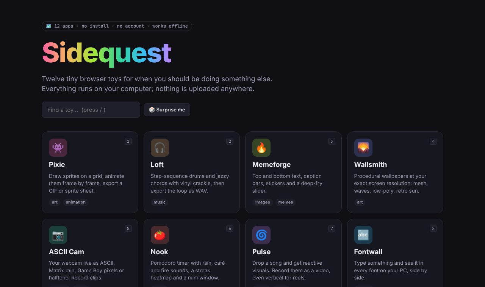

</div>

## Quick start

1. [Download the ZIP](https://github.com/FlameBLIZZard/sidequest/archive/refs/heads/main.zip) and unzip it anywhere.
2. Double-click **`index.html`** (or `start.bat` on Windows).
3. Pick a toy. Press `1`–`=` on the launcher to jump straight to one, or `/` to search.

That's it. Every app is a plain HTML file, so you can also open any `apps/<name>/index.html` directly or bookmark it.

> Chrome or Edge give the best experience (MP4 recording, listing every installed font, the floating focus timer). Firefox and Safari work for almost everything else.

## The apps

| | App | What it does | Saves as |
|---|---|---|---|
| 👾 | **[Pixie](apps/pixel/)** | Pixel art editor with frames, onion skin, mirror drawing, fill, line, rect, circle and move tools. Built-in PICO-8, Game Boy and Sweetie 16 palettes. | GIF, sprite sheet PNG, PNG, `.pixie` project |
| 🎧 | **[Loft](apps/lofi/)** | Lo-fi beat maker. 16-step drums, a four-bar jazzy chord progression in any key, bass line, sparkle melody, vinyl crackle, tape wobble, warmth and room. Four presets plus randomize. | WAV loop (4, 8 or 16 bars) |
| 🔥 | **[Memeforge](apps/meme/)** | Classic top/bottom text, caption-bar memes, draggable emoji stickers, laser eyes and a deep-fry slider. Paste, drop or open any image. | PNG, JPG, clipboard |
| 🌄 | **[Wallsmith](apps/wallpaper/)** | Procedural wallpapers at your exact screen resolution (or 4K, ultrawide, phone). Mesh gradient, waves, low-poly, Bauhaus, retro sun and flow field, with seeds you can share. | PNG |
| 📷 | **[ASCII Cam](apps/asciicam/)** | Your webcam live as ASCII, color ASCII, Matrix rain, Game Boy pixels, pixel art or halftone. Works with a video file too. | PNG snapshot, MP4/WebM video, text |
| 🍅 | **[Nook](apps/focus/)** | Pomodoro timer with six generated ambient sounds (rain, brown noise, ocean, fireplace, café, birds), a streak heatmap and a tiny always-on-top window. | Your streak, in the browser |
| 🌀 | **[Pulse](apps/visualizer/)** | Music visualizer with six reactive styles. Drop a song, use the mic, or play the demo beat, then record it (vertical 1080×1920 works for reels). | MP4/WebM video with audio |
| 🔤 | **[Fontwall](apps/fonts/)** | Type something and see it in every font on your PC side by side. Filter, favorite, try weights and italics, load font files, click to copy the CSS. | Favorites, in the browser |
| 📢 | **[Boop](apps/soundboard/)** | 16-pad soundboard on your keyboard (`1234 QWER ASDF ZXCV`). Ten built-in sounds (airhorn, ba dum tss, sad trombone…), load your own clips or record from the mic. | Clips stay in the browser; WAV download |
| 💬 | **[Chatmock](apps/fakechat/)** | Chat screenshot maker for skits in three looks (green messenger, gamer chat, blue bubbles). Group chats, avatars, times, read ticks and an optional "skit" label. | PNG, clipboard |
| ✨ | **[Namewell](apps/names/)** | Name generator for projects, startups, fantasy and sci-fi characters, usernames, bands, heroes, pets, towns and Wi-Fi networks. Add your own word, filter by letter and length. | Favorites, clipboard |
| ⌨️ | **[Keyrace](apps/typing/)** | Typing test with timed, word-count, quote and **code** modes (auto-indent included), punctuation and numbers, a ghost of your best run and a history graph. | History, in the browser |

## Screenshots

<table>
<tr><td>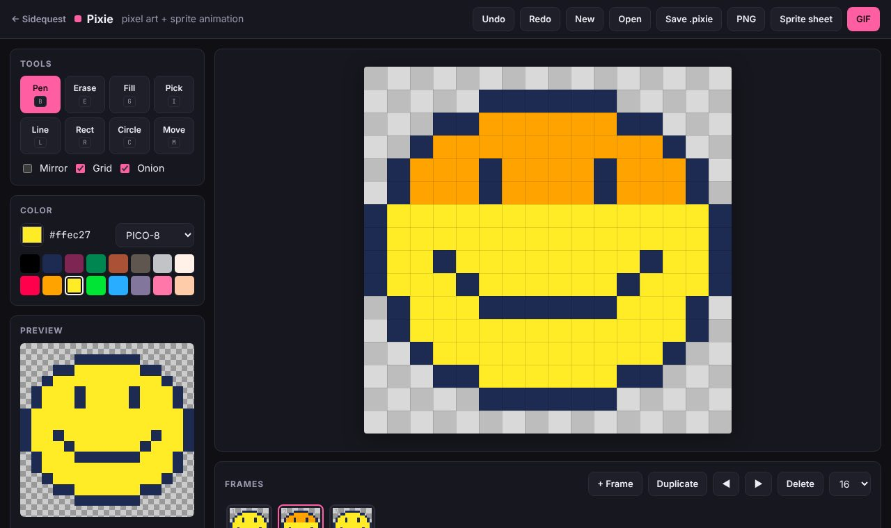<br><b>Pixie</b></td><td>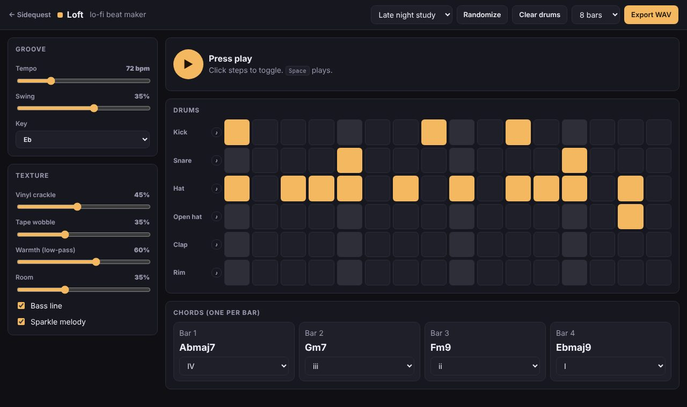<br><b>Loft</b></td><td>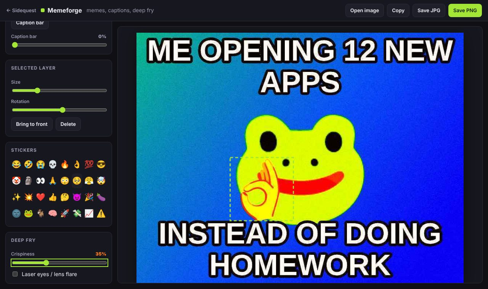<br><b>Memeforge</b></td></tr>
<tr><td>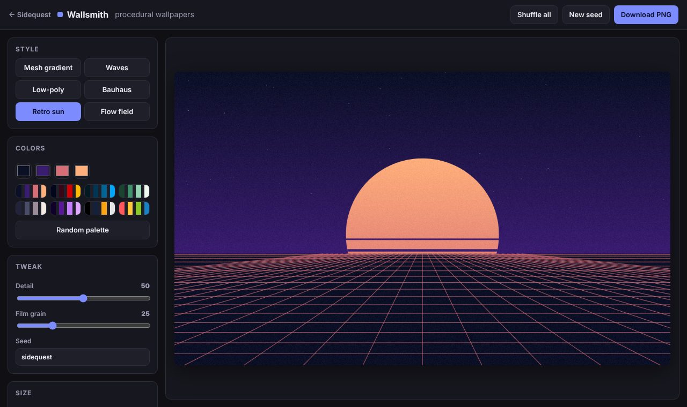<br><b>Wallsmith</b></td><td>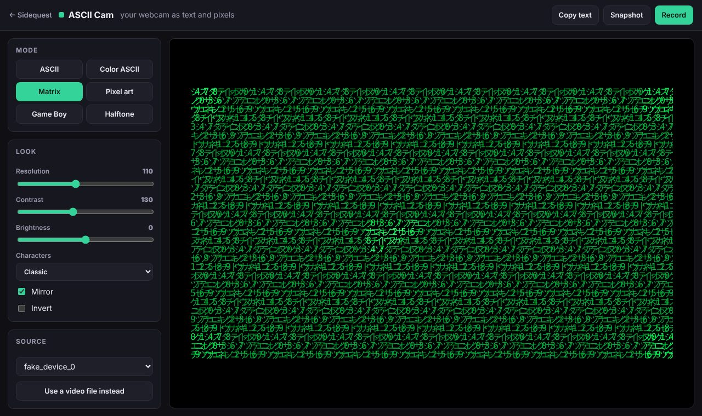<br><b>ASCII Cam</b></td><td>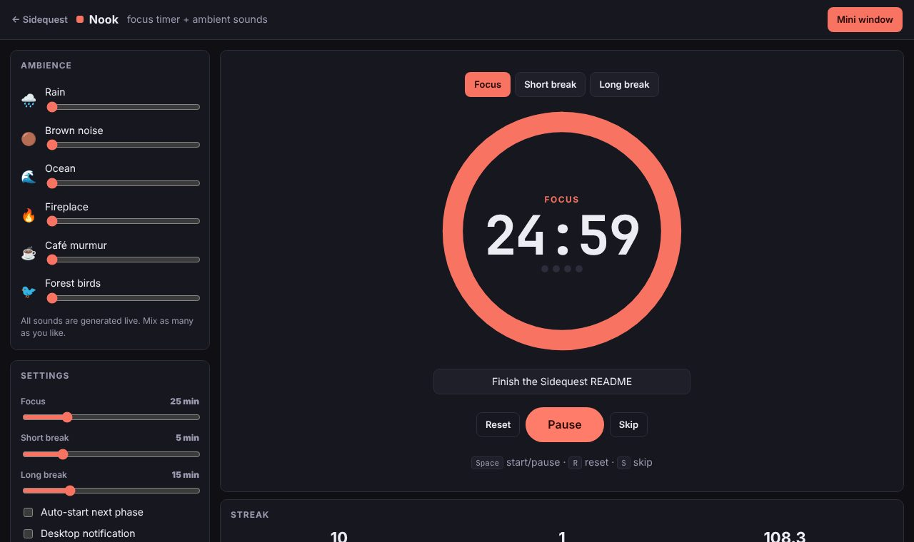<br><b>Nook</b></td></tr>
<tr><td>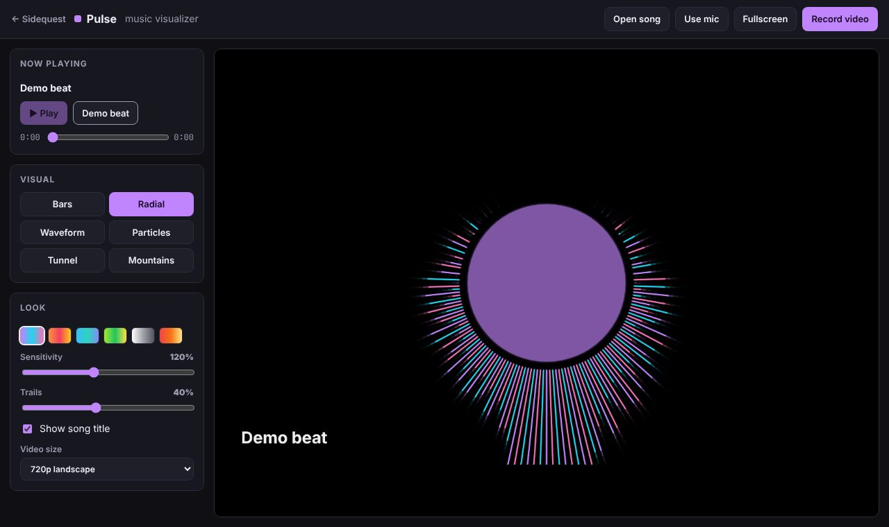<br><b>Pulse</b></td><td>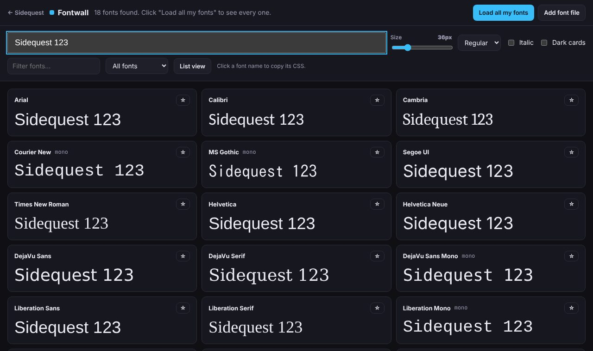<br><b>Fontwall</b></td><td>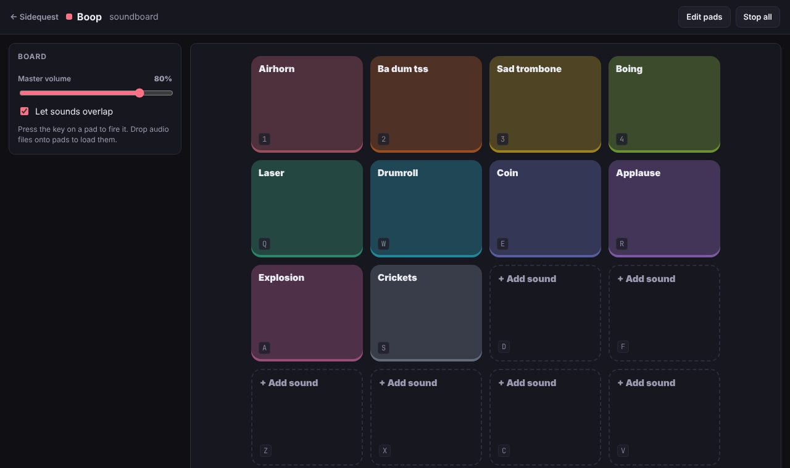<br><b>Boop</b></td></tr>
<tr><td>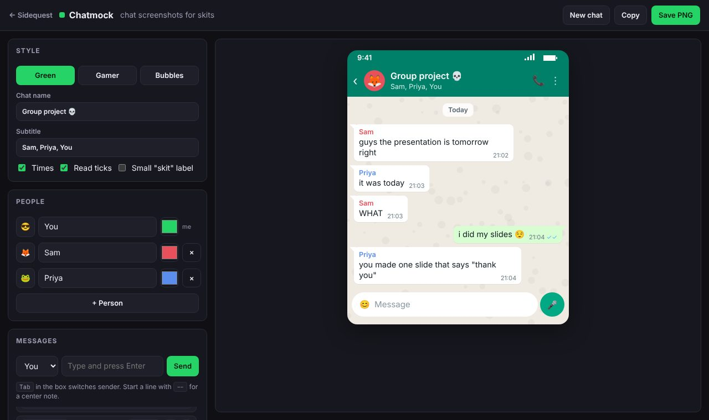<br><b>Chatmock</b></td><td>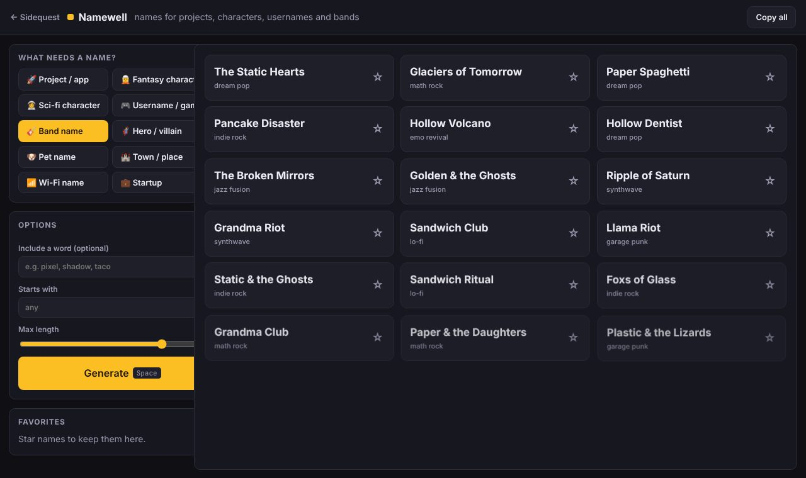<br><b>Namewell</b></td><td>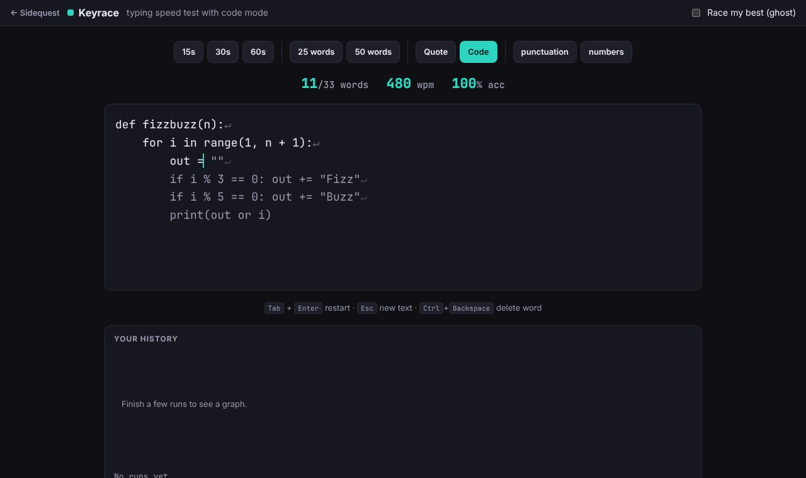<br><b>Keyrace</b></td></tr>
</table>

## Privacy

Nothing you make leaves your machine. There are no servers, analytics, cookies or network requests. Camera and microphone are used only while an app is showing them, and settings live in your browser's local storage. Clear your browser data to wipe them.

## Keyboard shortcuts

| Where | Keys |
|---|---|
| Launcher | `1`–`=` open an app, `/` search |
| Pixie | `B` pen, `E` erase, `G` fill, `I` pick, `L` line, `R` rect, `C` circle, `M` move, `,` `.` previous/next frame, `Ctrl+Z` / `Ctrl+Y` |
| Loft | `Space` play/stop |
| Nook | `Space` start/pause, `R` reset, `S` skip |
| Boop | pad keys `1234 QWER ASDF ZXCV`, `Esc` stop all |
| Namewell | `Space` generate |
| Keyrace | `Tab` then `Enter` restart, `Esc` new text, `Ctrl+Backspace` delete word |

## How it's built

Plain HTML, CSS and JavaScript. No framework, no bundler, no npm install needed to run anything.

```
sidequest/
├── index.html            launcher
├── shared/
│   ├── sq.css            shared look (tokens, buttons, panels, light/dark)
│   └── sq.js             helpers: downloads, storage, seeded RNG, WAV encoder, canvas recorder
├── apps/<name>/index.html   one self-contained app per folder
├── tests/smoke.mjs       opens every page in headless Chromium and fails on any error
└── docs/                 screenshots and the guide to adding an app
```

Audio is synthesized with the Web Audio API (every drum, chord, airhorn and rain drop is generated, not sampled), video is recorded with `MediaRecorder`, and the GIF encoder in Pixie is a few dozen lines of hand-written LZW.

## Contributing

Ideas, bug reports and new toys are all welcome. See [CONTRIBUTING.md](CONTRIBUTING.md) and [docs/adding-an-app.md](docs/adding-an-app.md). The short version:

```bash
git clone https://github.com/FlameBLIZZard/sidequest.git
cd sidequest
# open index.html in a browser, edit, refresh
npm test   # optional: smoke-tests every page (needs Playwright)
```

## License

[MIT](LICENSE). Use it, fork it, remix it, ship it.
